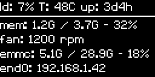
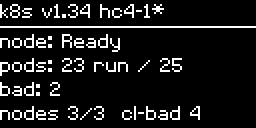
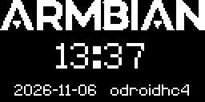
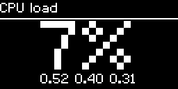
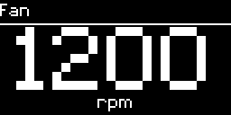
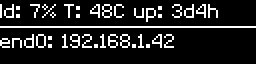

# sys-oled-hc4

System status on small **SSD1306-class I2C OLED displays** (also SH1106, SSD1305, SSD1309, SSD1315; 128x64 and 128x32)
on **any Linux board with `/dev/i2c-*`**:

- Amlogic (meson64: ODROID HC4, N2, C4…)
- Rockchip (rockchip64: RK3399, RK3566/RK3568, RK3588…)
- MediaTek Genio, Allwinner, Raspberry Pi
- x86 boxes with an I2C header

Bus, address, temperature sensor, network interface and storage are all auto-detected; nothing is board-specific.

> The name is historical: this started as the ODROID HC4 fork of [kobol-io/sys-oled](https://github.com/kobol-io/sys-oled)
> (all credit for the original idea goes there). The HC4 is still the reference board, but nothing here is HC4-only.

## What it shows

| Status | Kubernetes (in-cluster only) | Logo + clock |
|---|---|---|
|  |  |  |

| Big-font pages: load | temp | fan |
|---|---|---|
|  |  |  |

On 128x32 panels the status page keeps the header and network line:



`cycle.pages` sets which pages show and in what order. The default is `[status, kubernetes, logo]`; the big-font
`load`, `temp` and `fan` pages are readable from across the room. Pages that don't apply are skipped: `kubernetes`
outside a cluster, `fan` without a fan tachometer, `logo` with `cycle.logo: none`. Each page shows for
`cycle.refresh` seconds, except the logo page, which uses `cycle.logo_seconds` (default `refresh/2`). Then the panel
optionally turns off for `cycle.screen_off` seconds (saves the OLED from burn-in), and the cycle repeats.

The status page gets a `fan: N rpm` line when the board has a fan tachometer (hwmon `fan*_input`).

### Alerts


With `alerts.temp_max` (°C) and/or `alerts.fan_min` (rpm) set, the normal cycle is interrupted when the temperature
rises above the limit or any fan drops below the minimum, including during screen-off. The panel then shows a big
warning, flashing (inverted every 0.5s) unless `alerts.flash: false`, until the condition clears. A temperature alert
only clears 3°C below the limit, so it doesn't flicker. While alerts are enabled, the waits between pages re-check
these two values every 5 seconds; that costs two small sysfs reads. Both are off by default.

## Install

### Bare metal (Debian 13 Trixie+ / Ubuntu 25.04+, incl. Armbian)

```
curl -fsSL https://raw.githubusercontent.com/rpardini/sys-oled-hc4/master/install.sh | sudo bash
```

The script:

- installs **distro packages only**: `python3-luma.oled`, `python3-psutil`, `python3-pil`, `python3-smbus2`,
  `python3-yaml`, `git` (no pip, no venv, no compilers);
- clones (or updates) this repo into `/usr/src/sys-oled-hc4`;
- loads `i2c-dev` now and at boot;
- installs `sys-oled.service`;
- runs `sys-oled detect` and only enables the service if a display is found.

Environment overrides: `SYS_OLED_REF` (branch/tag/commit, default `master`), `SYS_OLED_DIR`, `SYS_OLED_REPO`, and
`SYS_OLED_FORCE=1` (enable even without a detected display). Pass them after `sudo`, e.g. `| sudo SYS_OLED_REF=v2.0.0 bash`.

### Upgrading (bare metal)

Run the same command again:

```
curl -fsSL https://raw.githubusercontent.com/rpardini/sys-oled-hc4/master/install.sh | sudo bash
```

It refreshes the apt packages and resets the checkout in `/usr/src/sys-oled-hc4` to `SYS_OLED_REF` (default `master`).
Local edits in the checkout are discarded; customize through `/etc/sys-oled.yaml` and `/etc/sys-oled.d/` instead.
It then reinstalls the unit, applies any pending migrations, re-runs detection and restarts the service.
Your config files are never overwritten.

- Pin or roll back to a specific version: `curl ... | sudo SYS_OLED_REF=v2.0.0 bash`. Use a tag, a branch or a commit.
- Check what's running: `git -C /usr/src/sys-oled-hc4 log -1 --oneline` and `journalctl -u sys-oled -b`.
- Config keys added by newer versions default sensibly, so nothing needs editing. `sudo sys-oled config --defaults`
  lists every key, and `sudo sys-oled config` shows what is in effect.
- If detection fails during an upgrade (panel unplugged?), the checkout is already updated but the service is not
  restarted. Fix the hardware and re-run, or add `SYS_OLED_FORCE=1`.

Installs from before 2.0 upgrade the same way; see [Upgrading from older versions](#upgrading-from-older-versions).

### Docker compose

See [`deploy/compose.yaml`](deploy/compose.yaml): `docker compose -f deploy/compose.yaml up -d`.
The image (`ghcr.io/rpardini/sys-oled-hc4`, amd64/arm64/armv7/riscv64) uses the same Debian packages.
It needs host networking and host PID, plus `/dev` and the host root (read-only) mounted, so it reports on the host
rather than the container. The host must have the `i2c-dev` module loaded.

Don't run the systemd service and a container at the same time; both would drive the same panel.

### Kubernetes (Helm)

```
helm install sys-oled oci://ghcr.io/rpardini/sys-oled-hc4/charts/sys-oled
kubectl label node <node-with-oled> sys-oled/enabled=true
```

The DaemonSet only runs on labeled nodes and adds a Kubernetes status page: version, node readiness, pods on this node,
broken pods, cluster node and pod counts. RBAC is read-only: nodes get/list/watch, pods list.

Per-node configuration comes from **node labels and annotations** and is applied live, without restarting the pod:

```
kubectl label node hc4-1 sys-oled/display.rotate=0 --overwrite
kubectl label node hc4-1 sys-oled/cycle.screen_off=300 --overwrite
kubectl annotate node hc4-1 'sys-oled/sensors.thermal=re:^bigcore' --overwrite
kubectl annotate node hc4-1 'sys-oled/storage.mounts=[{label: md0, path: /mnt/md0}]' --overwrite
```

Labels suit simple values. Annotations take any YAML value and win over labels. Cluster-wide defaults go in the chart's
`config:` value. On nodes without a panel, or with the panel unplugged, the pod idles and re-probes instead of
crash-looping.

### Uninstalling / switching deployments

Only one deployment should drive a panel at a time. To remove the bare-metal install:

```
curl -fsSL https://raw.githubusercontent.com/rpardini/sys-oled-hc4/master/install.sh | sudo bash -s -- --uninstall
```

This stops and disables the service (blanking the display), then removes the unit, `/usr/local/bin/sys-oled` and the
checkout. It keeps `/etc/sys-oled.yaml`, `/etc/sys-oled.d/` and i2c-dev loading at boot, which compose and Kubernetes
deployments also need, so a later reinstall picks the config up again. `--purge` removes those too, along with any
pre-2.0 leftovers. Apt packages are never removed, since they are shared distro libraries.

Switching the other way: `docker compose -f deploy/compose.yaml down` for compose. For Kubernetes, either
`kubectl label node <node> sys-oled/enabled-` (just that node) or `helm uninstall sys-oled`. The pod blanks the panel
when it stops.

## Auto-detection

Everything is detected once at startup. After that, the per-cycle work is a few `/proc` reads, one temperature file,
one ioctl and a `statfs` per shown mount. Detection only reruns when something fails, or when the kernel signals a
mount-table or network change (mountinfo `POLLPRI`, netlink route events).

- **Display:** probes every `/dev/i2c-N` at 0x3c then 0x3d with a read-byte probe, like `i2cdetect -r`
  (works on adapters without quick-write, e.g. MediaTek). It skips DP-AUX/DDC/HDMI adapters and addresses already
  claimed by a kernel driver. No `i2c-tools` needed.
- **Temperature:** scans thermal zones and hwmon, then picks by tier:
  1. SoC/package sensors (`soc-thermal`, `x86_pkg_temp`, coretemp "Package id", k10temp Tctl);
  2. CPU sensors, showing the hottest (`cpu-thermal`, per-core/cluster zones on Genio, `bigcore*`/`littlecore` on RK3588);
  3. generic SoC sensors;
  4. anything else except GPU/NPU/DDR/battery/NVMe/Wi-Fi sensors.
- **Fans:** every hwmon fan tachometer (`fan*_input`). `sensors.fan` can pick some by regex, or `none` to disable.
- **Network:** the interface holding the default route, with its IPv4 address.
- **Storage:** `/` first, then the largest real filesystems, one per device or ZFS pool. Bind mounts, btrfs subvolumes,
  zram/log2ram, snaps, `/boot` and container/kubelet mounts are ignored. Labels come from the device type: `sd`, `emmc`,
  `nvme`, `sata`, `usb`, `md0`, LVM name or pool name.

`sudo sys-oled detect` shows what was found and why.

## Configuration

One YAML schema covers everything, from these sources (lowest to highest precedence):

1. built-in defaults
2. `/etc/sys-oled.yaml`
3. `/etc/sys-oled.d/*.yaml`, in lexical order (drop-ins)
4. environment variables `SYS_OLED_<SECTION>_<KEY>`, e.g. `SYS_OLED_DISPLAY_ROTATE=0`
5. Kubernetes node labels `<prefix>/<section>.<key>` (in-cluster only)
6. Kubernetes node annotations, same keys (in-cluster only)
7. command-line flags, e.g. `--display-rotate 0`

The systemd unit carries no options. `sys-oled config` prints the effective configuration and where each value came
from. `sys-oled config --defaults` prints the template below.

```yaml
display:
  model: ssd1306                 # ssd1306 | ssd1305 | ssd1309 | ssd1315 | sh1106
  i2c_bus: auto                  # auto | bus number N (/dev/i2c-N)
  i2c_address: auto              # auto | 0x3c | 0x3d
  width: 128                     # pixels
  height: 64                     # pixels; 64 or 32
  rotate: 2                      # 0-3, quarter turns (luma semantics)
  contrast: 255                  # 0-255
cycle:
  refresh: 10                    # seconds per page (the logo page uses logo_seconds)
  pages: [status, kubernetes, logo] # status kubernetes logo, big-font load temp fan; inapplicable ones skipped
  logo: armbian                  # armbian | none | /path/to/1bit.png
  logo_seconds: auto             # seconds on the logo page; auto = refresh/2
  screen_off: 0                  # seconds the panel stays off each cycle; 0 = never
sensors:
  network: auto                  # auto (default route) | interface name
  thermal: auto                  # auto | sensor name | "re:<regex>"
  fan: auto                      # auto (all hwmon fans) | none | "re:<regex>" on hwmon:fanN
alerts:
  temp_max: 0                    # C; above it the panel wakes and flashes a warning; 0 = off
  fan_min: 0                     # rpm; any fan below it triggers the warning; 0 = off
  flash: true                    # invert the warning page every 0.5s (false: steady)
storage:
  auto: true                     # fill free lines with ranked auto-detected mounts
  mounts: []                     # explicit, shown first: [{label: md0, path: /mnt/md0}]
host:
  root: /                        # host / as seen by sys-oled; containers use /host
  missing_display: exit          # exit (code 3) | wait (re-probe every 60s)
kubernetes:
  enabled: auto                  # auto (in-cluster service account present) | true | false
  prefix: sys-oled               # node label/annotation prefix
  refresh: 60                    # max age (s) of k8s page data; fetched only when the page shows
  cluster_pods: true             # also count not-running pods cluster-wide
```

## Upgrading from older versions

Re-running the installer migrates pre-2.0 installs, including those deployed by older Armbian helper scripts:

- `/etc/sys-oled.conf` (INI) is converted to `/etc/sys-oled.yaml`; the original is kept as `/etc/sys-oled.conf.migrated`.
- Display model and rotation flags from the old systemd unit move to `/etc/sys-oled.d/50-migrated-unit.yaml`.
  A hardcoded `--i2c-port` is dropped on purpose, because bus numbers change between kernels and the bus is now
  detected at every start.
- The old copied (and sometimes `sed`-patched) `/usr/local/bin/sys-oled` becomes a symlink into the checkout.
  `/usr/local/share/sys-oled` is removed.
- A legacy `network_name = eth0` that no longer exists (e.g. renamed to `end0`) falls back to the default-route
  interface with a warning.

The legacy INI file and the old luma-style flags (`--display`, `--i2c-port`, `--rotate`…) are still understood.

## Development

```
uv sync                                   # dev env (Python 3.13, same floors as Trixie's packages)
uv run pytest
uv run ruff check . && uv run ruff format --check .
uv run sys-oled -c etc/sys-oled.yaml render --sample --page status --png /tmp/status.png --scale 4
uv run scripts/build_assets.py            # regenerate the logo bitmaps from assets-src/logo-armbian.svg
```

`render` needs no hardware, so pages can be developed on any OS. CI also runs the test suite on Debian Trixie and
Ubuntu 25.04/26.04 using only the distro packages. After changing the config schema, regenerate the shipped template
with `uv run sys-oled config --defaults > etc/sys-oled.yaml`; a test checks it is current.

The Armbian logo is vendored from [armbian/stationery](https://github.com/armbian/stationery) (see
[`assets-src/README.md`](assets-src/README.md)).
